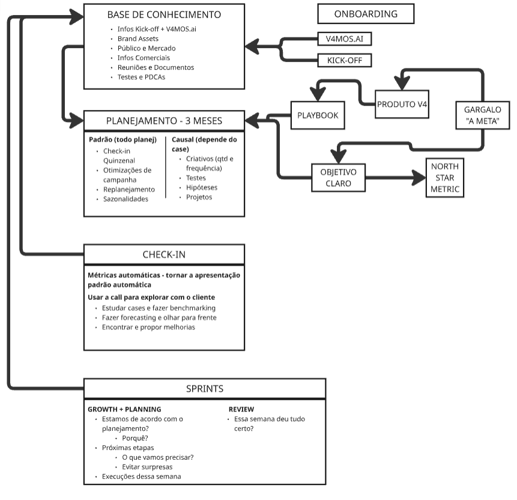

# Mapa geral — a arquitetura do usuário

> Fonte: fluxograma desenhado à mão pelo usuário e passado a sistema em 23/09/2026
> (`imagens/fluxograma-1.png` a `-3.png`). Este arquivo transcreve o desenho em texto e marca o
> status de cada bloco no dump. **A arquitetura ainda não está fechada.**

## O desenho



É um **laço**, não uma linha. A informação entra pelo onboarding, mora na Base, alimenta o
planejamento, e os rituais (check-in e sprints) **devolvem** para a Base.

```
ONBOARDING
  ├─ V4MOS.AI ──┐
  └─ KICK-OFF ──┴──► BASE DE CONHECIMENTO ◄──────────────┬──────────┐
                          │                              │          │
                          ▼                              │          │
                     PLANEJAMENTO — 3 MESES ◄── PLAYBOOK ◄── PRODUTO V4 ◄──┐
                          ▲                                                 │
                          └────────────── OBJETIVO CLARO ◄── GARGALO "A META"
                                               │
                                               └──► NORTH STAR METRIC
                                                                 │          │
                     CHECK-IN ───────────────────────────────────┘          │
                     SPRINTS  ──────────────────────────────────────────────┘
```

## Conteúdo de cada caixa, como está no desenho

**BASE DE CONHECIMENTO** — Infos Kick-off + V4MOS.ai · Brand Assets · Público e Mercado ·
Infos Comerciais · Reuniões e Documentos · Testes e PDCAs

**PLANEJAMENTO — 3 MESES**

| Padrão (todo planejamento) | Causal (depende do case) |
|---|---|
| Check-in quinzenal | Criativos (qtd e frequência) |
| Otimizações de campanha | Testes |
| Replanejamento | Hipóteses |
| Sazonalidades | Projetos |

**Entradas do planejamento:** Playbook ← Produto V4 ← Gargalo "a meta" · Gargalo → Objetivo
claro → North Star Metric · Objetivo claro → Planejamento

**CHECK-IN** — Métricas automáticas: tornar a apresentação padrão automática · Usar a call para
explorar com o cliente: estudar cases e fazer benchmarking, fazer forecasting e olhar para
frente, encontrar e propor melhorias

**SPRINTS** — *Growth + Planning:* estamos de acordo com o planejamento? por quê? · próximas
etapas: o que vamos precisar? evitar surpresas · execuções dessa semana — *Review:* essa semana
deu tudo certo?

## ⭐ O laço revisado — com o que o dump trouxe até o bloco 04

Três elementos entraram no desenho que **não estavam no fluxograma original**: gerar perguntas,
reunião interna de planejamento, e o Ekyte como etapa do fluxo.

```
COMERCIAL: gargalo → produto (STEP · Executar) → objetivo → North Star
     │
     ▼
GERAR PERGUNTAS  (Base + árvore do objetivo)                         ← novo (bloco 04)
     │
     ▼
ONBOARDING: V4MOS.ai (raso) + KICK-OFF (rico) ──► BASE DE CONHECIMENTO ◄──────────┐
                                                        │                         │
                                                        ▼                         │
                                   REUNIÃO INTERNA DE PLANEJAMENTO   ← novo        │
                                                        │                         │
                                                        ▼                         │
                         PLANEJAMENTO = PLAYBOOK (padrão) + ÁRVORE (causal)         │
                                                        │                         │
                                                        ▼                         │
                                   EKYTE — tarefas: gerenciar → medir   ← novo     │
                                                        │                         │
                                                        ▼                         │
                     EXECUÇÃO: humano + IA (skills lendo a Base, portões) ─────────┤ resultado de teste
                                                                                  │
                                      CHECK-IN ────────────────────────────────────┤
                                      SPRINTS  ────────────────────────────────────┘
```

⚠️ Rascunho. Os blocos 05–07 acrescentam ao laço: o check-in se parte em **relatório automático
(always-on)** + **reunião estratégica por exceção**; a sprint tem **pauta de desvios** e escreve
no Ekyte; as setas de volta são o **pipeline de ingestão** (transcrição → IA → Base, com aprovação
para o estável). Redesenhar o laço completo na consolidação.

## Status do dump

| # | Bloco | Status | Arquivos |
|---|---|---|---|
| 01 | Base de conhecimento | ✅ falado e analisado | [01](01-base-de-conhecimento.md) · [dump](dump/2026-09-23-01-base-de-conhecimento.md) |
| 02 | Onboarding (V4MOS.ai + Kick-off) | ✅ falado e analisado | [02](02-onboarding.md) · [dump](dump/2026-09-23-02-onboarding.md) |
| 03 | Produto · Gargalo · Objetivo · North Star · Playbook | ✅ falado e analisado | [03](03-produto-gargalo-playbook.md) · [dump](dump/2026-09-23-03-produto-gargalo-playbook.md) |
| 04 | Planejamento — 3 meses | ✅ falado e analisado | [04](04-planejamento.md) · [dump](dump/2026-09-23-04-planejamento.md) |
| 05 | Check-in | ✅ falado e analisado | [05](05-check-in.md) · [dump](dump/2026-09-23-05-check-in-e-sprints.md) |
| 06 | Sprints | ✅ falado e analisado | [06](06-sprints.md) · [dump](dump/2026-09-23-05-check-in-e-sprints.md) |
| 07 | Ingestão das reuniões (transversal — as setas de volta) | ✅ falado e analisado | [07](07-ingestao-das-reunioes.md) · [dump](dump/2026-09-23-05-check-in-e-sprints.md) |

| 08 | Respostas às questões — rodada 1 (1 a 15) | ✅ registrada | [08](08-respostas-rodada-1.md) · [dump](dump/2026-09-23-06-respostas-q01-q15.md) |
| 09 | Respostas — rodada 2 (Q3, N1–N3, 16 a 33) | ✅ registrada | [09](09-respostas-rodada-2.md) · [dump](dump/2026-09-23-07-respostas-q03-q33.md) |
| 10 | Inventário: existe × sem rotina × não existe | ✅ consolidado | [10](10-inventario-existe-nao-existe.md) |
| 11 | Respostas — rodada 3 (pendências) + conformidade recalculada | ✅ registrada | [11](11-respostas-rodada-3.md) · [dump](dump/2026-09-24-08-respostas-pendencias.md) |
| 12 | Growth Pack — a árvore de métricas do e-commerce | ✅ analisado | [12](12-growth-pack.md) |
| 13 | ⭐ **Consolidação da arquitetura** — camadas, fonte da verdade, laço, topologia, ordem | 🟡 proposta registrada | [13](13-consolidacao.md) |
| 14 | Acompanhamento de métricas sai da planilha e entra na topologia | 🟡 desenho registrado | [14](14-acompanhamento-de-metricas.md) · [dump](dump/2026-09-24-09-acompanhamento.md) |

✅ **Todos os blocos do fluxograma foram falados e todas as pendências respondidas (24/09).**
⭐ **Consolidação proposta em `13-consolidacao.md`** — o laço final está lá, substituindo o rascunho
acima. Próxima fase: **revisão da consolidação pelo usuário**, depois execução por fases — matriz de fonte da verdade, fluxos com gatilho, topologia, ordem
de execução.

⚠️ A numeração dos próximos arquivos segue a **ordem em que o usuário falar**, não a ordem do
desenho.
